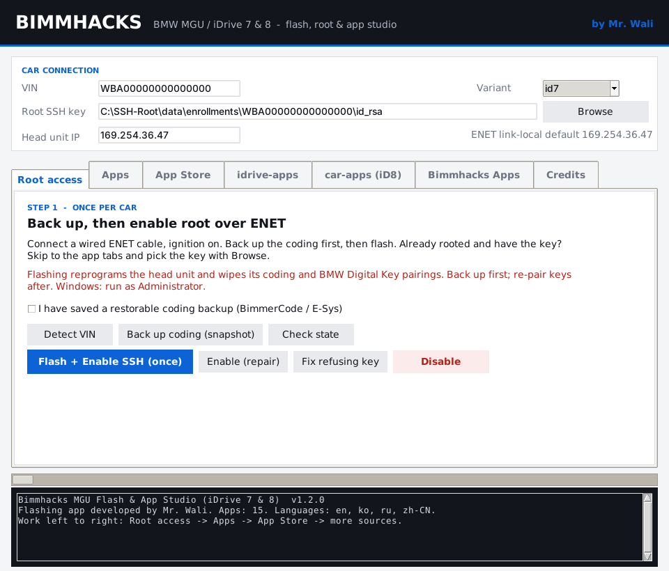
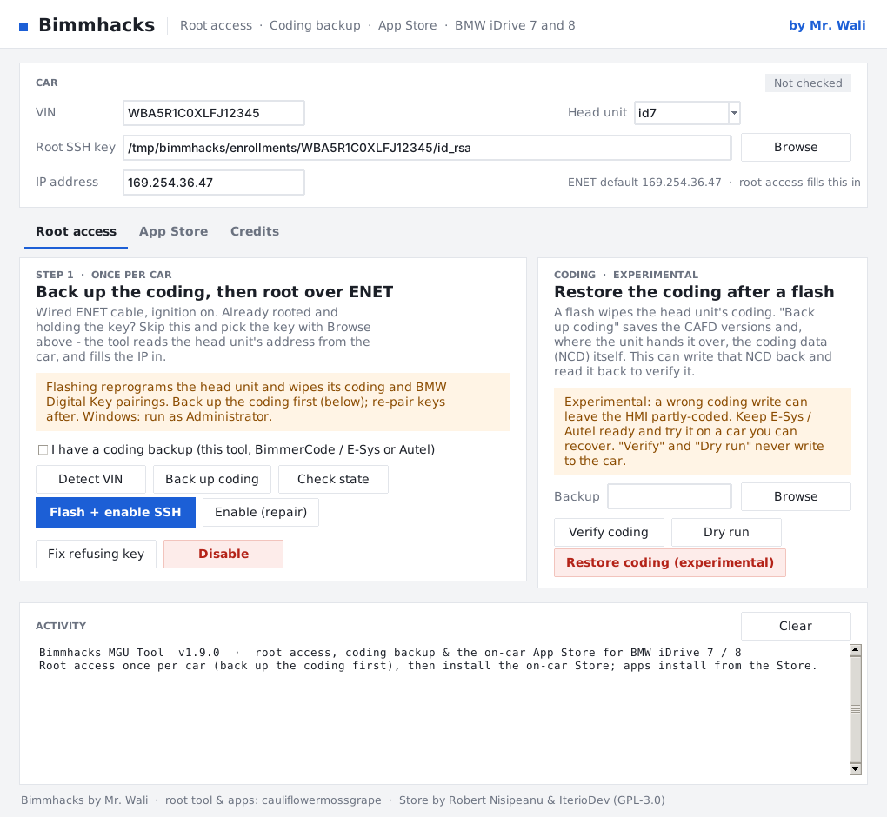
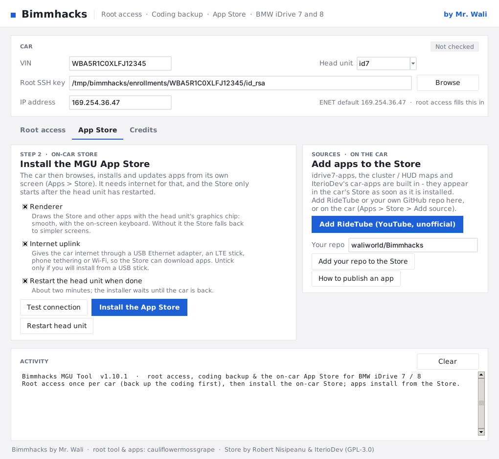
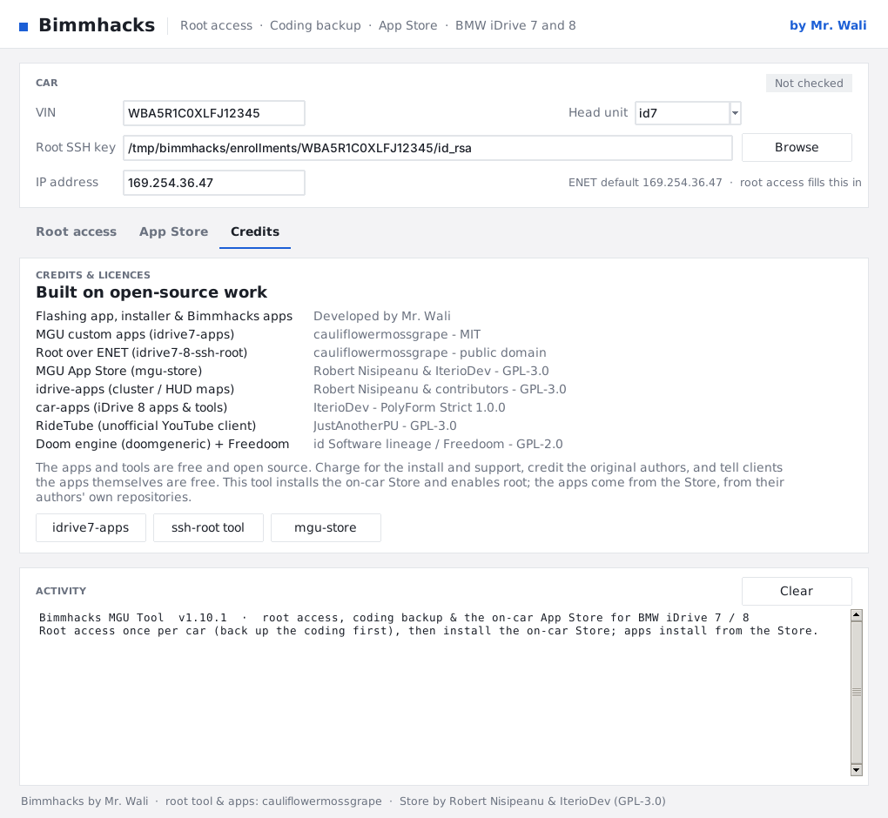

# Bimmhacks: root access, coding backup & the on-car App Store (iDrive 7 & 8)

A clean one-window tool for BMW **MGU head units (iDrive 7 & 8)** that a client runs on their own PC.
It does three things — the three that work reliably on a real car — and bundles the tools for each.
**Flashing app and installer developed by Mr. Wali**; the root tool and Store are open source (see the
Credits tab). Apps are **not** built on the PC: once the on-car Store is installed, every app installs
from the car's own screen.

- **Root access** — back up the coding, then enable root SSH over an ENET cable with the bundled
  [idrive7-8-ssh-root](https://github.com/cauliflowermossgrape/idrive7-8-ssh-root) tool (one flash
  per car; it writes the car's SSH key the rest of the flow uses). A flash **wipes the coding**, so the
  tool refuses to flash until you confirm a coding backup, and this version can take one for you.
- **Coding backup & restore (experimental)** — **Back up coding** reads the unit over ENET and saves
  the CAFD coding versions, VIN, faults and, where the unit hands it over, the coding data (NCD) itself
  as E-Sys-compatible `.ncd` files. The **restore** card can write that captured coding back after a
  flash and read it back to verify — gated, with Verify and Dry-run modes that never write. Keep
  BimmerCode / E-Sys / Autel ready: a wrong coding write can leave the HMI partly-coded.
- **App Store** — install the on-car [mgu-store](https://github.com/robertnisipeanu/mgu-store) (its
  renderer and internet uplink), restart the head unit so it comes up, and add **RideTube** (and your
  own GitHub repo) to the Store's sources in one click. From there the client browses, installs and
  updates apps from the car screen — including Robert Nisipeanu's
  [idrive-apps](https://github.com/robertnisipeanu/idrive-apps) and
  [IterioDev's car-apps](https://github.com/IterioDev/car-apps), built-in Store sources.
- **Credits** — the people behind every part.

**No laptop? Bimmhacks Pocket** is the phone version, released as its **own** package: a small box (a
Raspberry Pi) on the ENET cable runs the same engine and serves a lightweight page over its own Wi-Fi —
root access, the coding backup/restore and the App Store from an iPhone or Android, with the same safety
gates. Build and use: [docs/POCKET.md](docs/POCKET.md) (`installer/pocket_server.py`,
`installer/pocket/setup-box.sh`).



### A tour of the window

<table>
<tr>
<td width="33%"><br><sub><b>Root access.</b> Back up the coding, flash + enable SSH; the experimental coding-restore card is on the right.</sub></td>
<td width="33%"><br><sub><b>App Store.</b> Install the on-car Store and restart the head unit; add RideTube or your own repo as a source.</sub></td>
<td width="33%"><br><sub><b>Credits.</b> The people and projects behind every part.</sub></td>
</tr>
</table>

Three tabs, worked left to right — nothing else:

- **Root access.** Detect the VIN by broadcast, **back up the coding** over ENET, then **Flash + enable
  SSH** (gated: it refuses until you confirm you have a coding backup, and says what the flash wipes).
  The card on the right is the experimental **coding restore** — Verify / Dry run / Restore, which can
  write the captured coding (NCD) back after a flash and read it back to check.
- **App Store.** Install the on-car MGU **App Store** (its renderer and internet uplink, each explained),
  and the installer restarts the head unit for you so the Store comes up. Add **RideTube** (and your own
  repo) to it in one click — from there every app installs on the car, from the Store.
- **Credits.**

The hero shot was taken on Linux against the test suite's fake car (no real car), so Windows shows the
same window in Segoe UI with its native dialogs. Regenerate it with `installer/tests/desktop_shots.py`
(needs `python3-tk`, Xvfb and ImageMagick).

## Backing up the coding

Before any flash, **Back up coding** reads the car over ENET into `coding-backups/`: the CAFD coding
versions, VIN, IP and faults (*what to restore*) and, where the unit hands it over, the coding data
(NCD) itself as E-Sys-compatible `.ncd` files (*the coding to restore*).

The **restore** is experimental and safe-by-construction: it only ever writes back the exact NCD it
read, only to the coding identifiers it read, gates on a CAFD-versions-and-VIN match, requires a typed
confirmation, and reads every block back to verify. **Verify** and **Dry run** never write. Even so, a
coding write can leave the HMI partly-coded, so keep BimmerCode / E-Sys / Autel ready as the fallback
(the `.ncd` files load straight into E-Sys). The flash still refuses until you confirm you have a
backup — from this tool, BimmerCode, E-Sys or Autel.

## What's in this repository

| Path | What |
|---|---|
| `Install Bimmhacks Apps.cmd` | **Windows:** double-click. Installs Python + Node.js (winget) if needed, offers to elevate, opens the window |
| `Install Bimmhacks Apps.command` / `install.sh` | macOS / Linux launcher |
| `installer/bimmhacks_installer.py` | the installer (window + command line), Python standard library + `cryptography` for root access |
| `installer/coding_backup.py` | the coding engine: snapshot + NCD backup / verify / restore over ENET |
| `installer/windows/bootstrap.ps1` | the Windows prerequisite / elevation check behind the `.cmd` |
| `installer/make_client_package.py` | builds the two client zips (PC installer + Pocket box) |
| `installer/pocket_server.py`, `installer/pocket/` | Bimmhacks Pocket: the box server + phone page (shipped in the Pocket zip) |
| `tools/idrive7-8-ssh-root/` | the root-access tool (public domain) |
| `tools/mgu-store/` | the on-car App Store installer (`mgu-install.js`, GPL-3.0) |
| `idrive7-apps/` | app sources & tools (not shipped in either zip — apps install from the on-car Store) |
| [CLIENT-GUIDE.md](CLIENT-GUIDE.md) | step-by-step guide for clients (goes into the PC zip) |
| [docs/Store-Sources.pdf](docs/Store-Sources.pdf) | recommended app repos not bundled with the Store: the exact text to add each on the car, by iDrive 7 / 8, with links (PC zip). Built from `docs/store-sources.json` by `installer/make_store_sources_pdf.py` |

## Making the packages for clients

The PC installer and the Pocket box are **separate releases** — a change to one never holds up the other:

```sh
python3 installer/make_client_package.py          # both zips, into dist/
python3 installer/make_client_package.py --pc      # only the PC installer
python3 installer/make_client_package.py --pocket  # only the Pocket box
# -> dist/Bimmhacks-MGU-Installer-<version>.zip   the desktop app (no Pocket code, no BMW SDK, no keys)
# -> dist/Bimmhacks-Pocket-<version>.zip          the Raspberry Pi box (server + phone page + engine)
```

GitHub Actions builds both zips on every push (*Actions → Client installer package → artifacts*), and
checks that neither carries a BMW SDK or client SSH key and that the PC zip has no Pocket code. Send the
PC zip with [CLIENT-GUIDE.md](CLIENT-GUIDE.md); the client unzips it and double-clicks
`Install Bimmhacks Apps.cmd`. The Pocket zip goes onto the box — see [docs/POCKET.md](docs/POCKET.md).

## Command line

```sh
python3 installer/bimmhacks_installer.py backup-coding --out coding-backups        # snapshot + NCD backup
python3 installer/bimmhacks_installer.py verify-coding --backup <backup.json>      # read-only: does the car match?
python3 installer/bimmhacks_installer.py restore-coding --backup <backup.json> --dry-run   # show, write nothing
python3 installer/bimmhacks_installer.py restore-coding --backup <backup.json> --confirm-restore  # EXPERIMENTAL write-back
python3 installer/bimmhacks_installer.py root-flash --vin <VIN> --confirm-backup   # enable root SSH (ENET); refuses without the flag
python3 installer/bimmhacks_installer.py store-install --key <id_rsa> --restart    # install the App Store, restart the head unit
python3 installer/bimmhacks_installer.py restart-head-unit --key <id_rsa>          # restart it (the Store only starts after one)
python3 installer/bimmhacks_installer.py install-ridetube --key <id_rsa>           # add RideTube to the Store's sources
python3 installer/bimmhacks_installer.py install-idrive-apps --key <id_rsa>        # add cluster/HUD maps as a Store source
python3 installer/bimmhacks_installer.py install-our-apps --key <id_rsa> --repo owner/repo
python3 installer/pid_capture.py drive.pcapng                                      # identifiers a logger read (Wireshark capture)
```

## Requirements on the client PC

- Windows 10/11 (or macOS / Linux)
- Python 3.6+ with Tk; Node.js 14+ (the Windows launcher offers to install both)
- OpenSSH client (built into Windows 10/11, macOS, Linux)
- `cryptography` Python package for root access (installed on demand)
- an **ENET cable** for root access; the car parked, ignition on, charger connected
- internet **at the car** for the App Store step

## Credits and licence

- **Flashing app & Bimmhacks installer:** developed by **Mr. Wali**.
- Custom apps: **cauliflowermossgrape**, MIT — <https://github.com/cauliflowermossgrape/idrive7-apps>
- Root tool: **idrive7-8-ssh-root** by cauliflowermossgrape, public domain (Unlicense)
- App Store: **mgu-store** by Robert Nisipeanu and IterioDev, GPL-3.0 (`tools/mgu-store/LICENSE`)
- idrive-apps (cluster / HUD maps): Robert Nisipeanu and contributors, GPL-3.0
- car-apps (iDrive 8 apps & tools): IterioDev, PolyForm Strict 1.0.0 (not vendored — installed from
  its own repo through the Store)
- Doom app: GPL-2.0, source in `idrive7-apps/third_party/`

Keep each tool's licence and the credits the installer shows (Credits tab). The apps' authors ask
that nobody sell the apps as their own work: charge for your installation service and support, credit
the originals, and tell clients the apps themselves are free. BMW's SDK is never redistributed.
