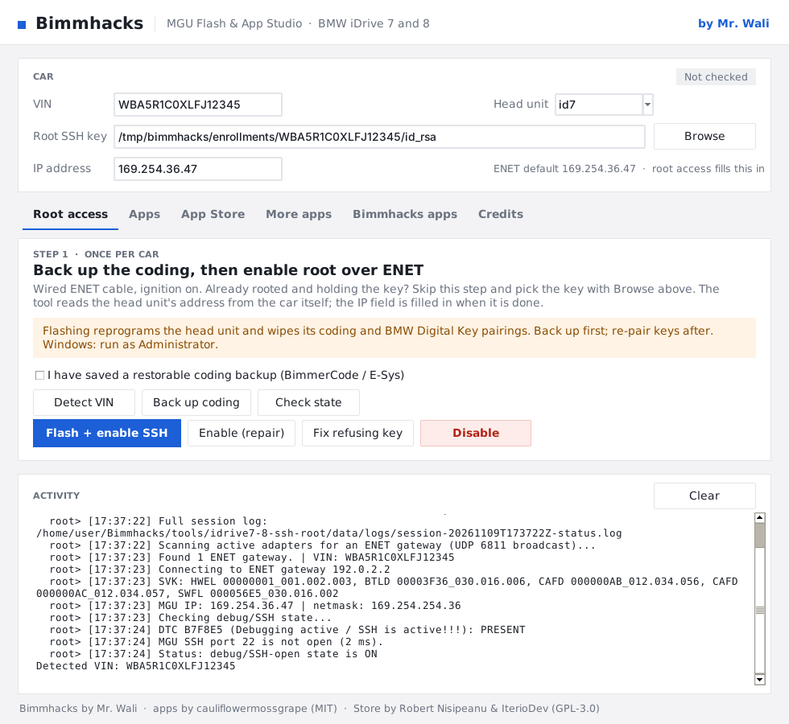
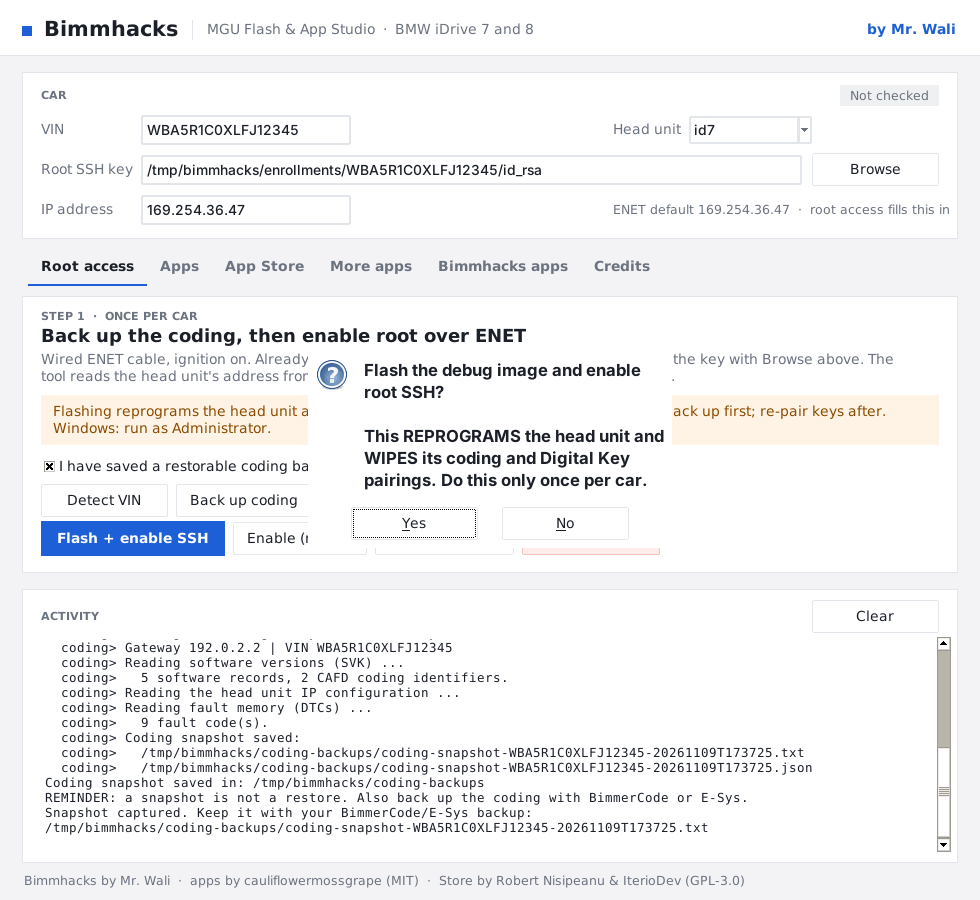
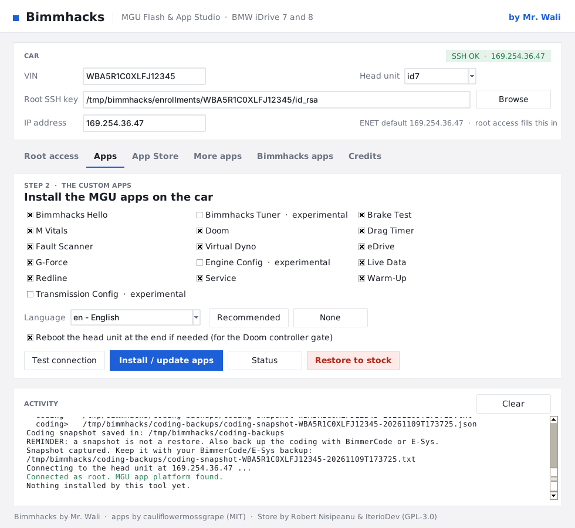
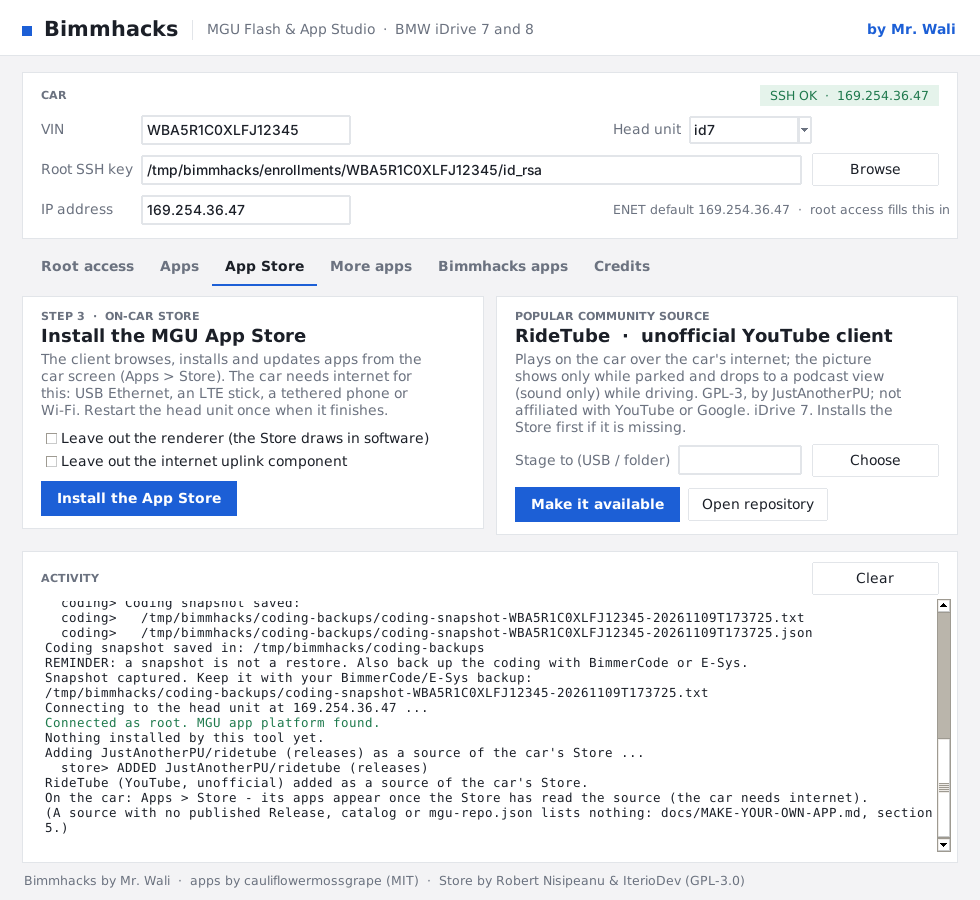
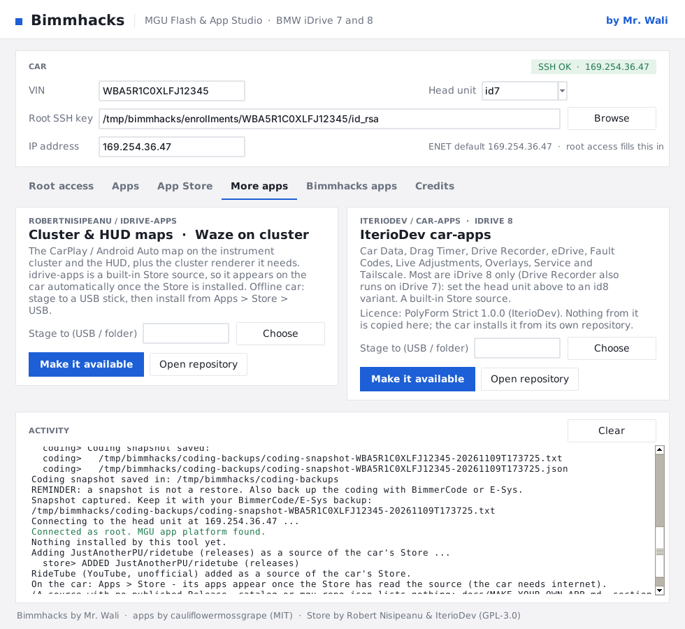
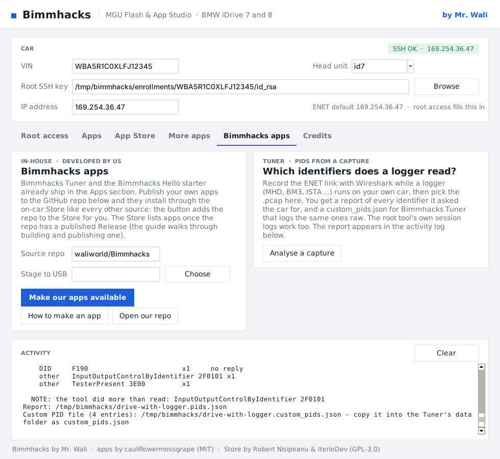

# Bimmhacks: MGU Flash & App Studio (iDrive 7 & 8)

A clean one-window tool for BMW **MGU head units (iDrive 7)** that a client runs on their own PC. It
takes a car from stock to installed apps, and bundles the tools for each stage. **Flashing app and
installer developed by Mr. Wali**; the apps, root tool and Store are open source (see the Credits tab).

- **Root access** — back up the coding, then enable root SSH over an ENET cable with the bundled
  [idrive7-8-ssh-root](https://github.com/cauliflowermossgrape/idrive7-8-ssh-root) tool (one flash
  per car; it writes the car's SSH key the rest of the flow uses).
- **Apps** — the [MGU custom apps](https://github.com/cauliflowermossgrape/idrive7-apps), built per
  car: it reads BMW's SDK off that car (never shipped — BMW's code), builds the chosen apps and
  language, installs them with a full backup, then deletes the SDK and build output.
- **App Store** — install the on-car [mgu-store](https://github.com/robertnisipeanu/mgu-store) so the
  client browses, installs and updates apps from the car screen afterwards.
- **idrive-apps** — make Robert Nisipeanu's
  [idrive-apps](https://github.com/robertnisipeanu/idrive-apps) (cluster / HUD maps) available
  through the Store, online or staged to USB. It is a built-in Store source: the Store lists it as
  soon as it is installed. **RideTube** and your own repo are different: the installer **adds them
  to the Store's sources for you** (it asks the Store's updater over ssh), so they are a normal
  download under *Apps → Store* on the car.
- **car-apps** — [IterioDev's car-apps](https://github.com/IterioDev/car-apps), iDrive 8 focused
  (PolyForm Strict licence), through the Store the same way.
- **Bimmhacks Apps** — apps developed in-house, from your own GitHub source. A working starter app,
  **Bimmhacks Hello**, ships in the Apps tab; copy it to build your own. Full walkthrough:
  [docs/MAKE-YOUR-OWN-APP.md](docs/MAKE-YOUR-OWN-APP.md). The same tab has **Analyse a capture**:
  give it a Wireshark capture of the ENET link recorded while a logger (MHD, BM3, ISTA …) ran on
  *your own* car and it lists every identifier the logger read, and writes a `custom_pids.json` for
  the Tuner that logs the same ones ([installer/pid_capture.py](installer/pid_capture.py)).
- **Bimmhacks Tuner** (in the Apps tab, marked experimental) — our own app: live gauges (boost, load,
  timing, lambda, knock), a CSV datalogger with switchable **log packs** (tuning, engine, per-cylinder, the
  eight MHD-capture identifiers logged raw, and your own `custom_pids.json`), the engine unit's fault codes
  and, for a car that *already* runs a multi-map tune, map switching. **It never flashes or writes a tune**, and map switching ships
  off. Not yet tested on a car. Details: [idrive7-apps/apps/bimmhacks_tuner/README.md](idrive7-apps/apps/bimmhacks_tuner/README.md).
- **Credits** — the people behind every part.

Plus **coding snapshot**, **Status** and **Restore to stock**.

**No laptop? Bimmhacks Pocket** is the phone version: a small box (a Raspberry Pi) on the ENET cable
runs the same installer and serves a lightweight page over its own Wi-Fi — root access, the coding
snapshot and the App Store from an iPhone or Android, with the same safety gates. Build and use:
[docs/POCKET.md](docs/POCKET.md) (`installer/pocket_server.py`, `installer/pocket/setup-box.sh`).


### A tour of the window

<table>
<tr>
<td width="50%"><br><sub><b>Root access.</b> The car is found by broadcast; its VIN fills the field and the root tool's output streams into the activity log.</sub></td>
<td width="50%"><br><sub><b>The flash gate.</b> A coding snapshot is saved first; flashing asks again and says what it wipes. Without the backup tick it refuses (<a href="installer/screenshots/05-flash-needs-backup.png">screenshot</a>).</sub></td>
</tr>
<tr>
<td><br><sub><b>Apps.</b> Pick the apps and language; the chip shows the car is reachable as root.</sub></td>
<td><br><sub><b>App Store.</b> Install the Store, and add RideTube to it in one click: it is then a normal download on the car (<a href="installer/screenshots/09-ridetube-confirm.png">confirmation</a>).</sub></td>
</tr>
<tr>
<td><br><sub><b>More apps.</b> Cluster &amp; HUD maps, and IterioDev's iDrive 8 apps, both built-in Store sources.</sub></td>
<td><br><sub><b>Bimmhacks apps.</b> Your own source, and the capture analyser: which identifiers a logger read from your car.</sub></td>
</tr>
</table>

All fourteen steps, and a one-page [overview](installer/screenshots/00-overview.png), are in
`installer/screenshots/`. They were taken on Linux against the test suite's fake car (no real car), so
Windows shows the same window in Segoe UI with its native dialogs. Regenerate them with
`installer/tests/desktop_shots.py`.

## Backing up the coding

Before any flash, **Back up coding (snapshot)** reads the car over ENET and saves which CAFD coding
versions, VIN, IP and faults are on it (into `coding-backups/`). That records *what to restore*. It
is **not** a restorable backup on its own — the installer requires you to also confirm a
BimmerCode / E-Sys backup before it will flash.

## What's in this repository

| Path | What |
|---|---|
| `Install Bimmhacks Apps.cmd` | **Windows:** double-click. Installs Python + Node.js (winget) if needed, offers to elevate, opens the window |
| `Install Bimmhacks Apps.command` / `install.sh` | macOS / Linux launcher |
| `installer/bimmhacks_installer.py` | the installer (window + command line), Python standard library + `cryptography` for root access |
| `installer/coding_backup.py` | reads the coding snapshot (CAFD versions / VIN / faults) over ENET |
| `installer/windows/bootstrap.ps1` | the Windows prerequisite / elevation check behind the `.cmd` |
| `installer/make_client_package.py` | packs everything into one zip for clients |
| `idrive7-apps/` | the custom apps (upstream copy — see [UPSTREAM.md](UPSTREAM.md)) |
| `tools/idrive7-8-ssh-root/` | the root-access tool (public domain) |
| `tools/mgu-store/` | the on-car App Store installer (`mgu-install.js`, GPL-3.0) |
| [CLIENT-GUIDE.md](CLIENT-GUIDE.md) | step-by-step guide for clients (goes into the zip) |

## Making the package for clients

```sh
python3 installer/make_client_package.py
# -> dist/Bimmhacks-MGU-Installer-<version>.zip  (no BMW SDK, no built apps, no client keys)
```

GitHub Actions builds the same zip on every push (*Actions → Client installer package → artifact*),
and checks the zip carries no BMW SDK, built apps or client SSH keys. Send the zip with
[CLIENT-GUIDE.md](CLIENT-GUIDE.md); the client unzips it and double-clicks `Install Bimmhacks Apps.cmd`.

## Command line

```sh
python3 installer/bimmhacks_installer.py backup-coding --out coding-backups   # coding snapshot
python3 installer/bimmhacks_installer.py root-flash --vin <VIN> --confirm-backup   # enable root SSH (ENET); refuses without the flag
python3 installer/bimmhacks_installer.py install --key <id_rsa>     # build + install apps
python3 installer/bimmhacks_installer.py store-install --key <id_rsa>   # install the App Store
python3 installer/bimmhacks_installer.py install-idrive-apps --key <id_rsa>   # cluster/HUD maps
python3 installer/bimmhacks_installer.py install-our-apps --key <id_rsa> --repo owner/repo
python3 installer/bimmhacks_installer.py status|restore --key <id_rsa>
python3 installer/bimmhacks_installer.py apps                       # list apps + languages
python3 installer/pid_capture.py drive.pcapng                       # identifiers a logger read (Wireshark capture)
```

## Requirements on the client PC

- Windows 10/11 (or macOS / Linux)
- Python 3.6+ with Tk; Node.js 14+ (the Windows launcher offers to install both)
- OpenSSH client (built into Windows 10/11, macOS, Linux)
- `cryptography` Python package for root access (installed on demand)
- an **ENET cable** for root access; the car parked, ignition on, charger connected
- internet **at the car** for the App Store step

## Credits and licence

- **Flashing app & Bimmhacks installer:** developed by **Mr. Wali**.
- Custom apps: **cauliflowermossgrape**, MIT — <https://github.com/cauliflowermossgrape/idrive7-apps>
- Root tool: **idrive7-8-ssh-root** by cauliflowermossgrape, public domain (Unlicense)
- App Store: **mgu-store** by Robert Nisipeanu and IterioDev, GPL-3.0 (`tools/mgu-store/LICENSE`)
- idrive-apps (cluster / HUD maps): Robert Nisipeanu and contributors, GPL-3.0
- car-apps (iDrive 8 apps & tools): IterioDev, PolyForm Strict 1.0.0 (not vendored — installed from
  its own repo through the Store)
- Doom app: GPL-2.0, source in `idrive7-apps/third_party/`

Keep each tool's licence and the credits the installer shows (Credits tab). The apps' authors ask
that nobody sell the apps as their own work: charge for your installation service and support, credit
the originals, and tell clients the apps themselves are free. BMW's SDK is never redistributed.
