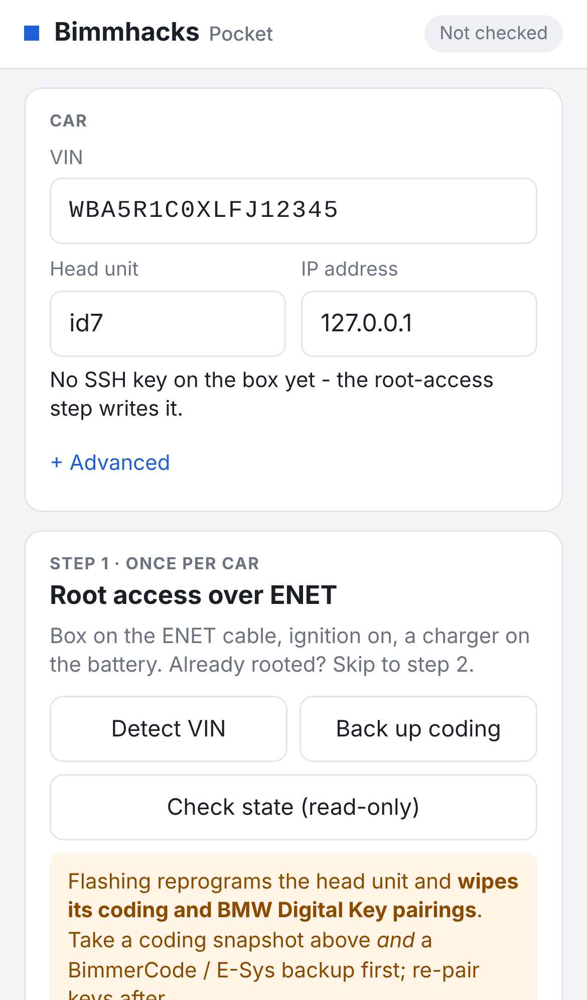

# Bimmhacks Pocket — the phone version

Root access and the on-car **MGU App Store** from a phone, with no laptop: a small box sits on the
ENET cable and does the work; the phone (iPhone or Android) joins the box's Wi-Fi and presses the
buttons. The page is lightweight on purpose — the three steps a car needs, and nothing else.



## Why a box and not a phone app

The car is driven over raw TCP (UDS over HSFZ, port 6801) and SSH. A web page cannot open those
connections, so no web-app builder can make this run in a browser. A native iPhone app could, but it
needs a Mac with Xcode, an Apple developer account and App Review before anyone can install it. The
box runs the exact same code as the desktop installer — the root tool, the coding snapshot, the Store
installer, the same safety gates — and the phone is only the screen.

## What you need

| Part | Notes |
|---|---|
| **Raspberry Pi 4** or **3B+** | built-in Ethernet and Wi-Fi. A Pi Zero 2 W works with a USB Ethernet adapter; any small Linux box with Ethernet + Wi-Fi does. |
| microSD card, 8 GB+ | with **Raspberry Pi OS Lite (Bookworm or newer)** — its Node.js is new enough; older releases are not. |
| **BMW ENET cable** | OBD → RJ45, into the box's Ethernet port. |
| USB power from the car | a Pi 4 wants 3 A: use a good 12 V → USB adapter, or a power bank. |
| Internet for the box **once** | to set it up and to download the Store package onto it. On the car the box is alone with the car. |

## Build the box (once)

1. Flash Raspberry Pi OS Lite to the card (Raspberry Pi Imager: set a user, enable SSH, and join your
   Wi-Fi so the box has internet for this step).
2. Copy the client zip onto the box and unzip it, e.g. to `/home/pi/Bimmhacks`.
3. Run the set-up script as root:

   ```sh
   cd /home/pi/Bimmhacks
   sudo sh installer/pocket/setup-box.sh --ssid Bimmhacks-Pocket --pass <wifi-password> --pin 2468
   ```

   It installs Python, Node.js, the OpenSSH client, NetworkManager and avahi; downloads the Store
   package (and Doom's game data) onto the box; sets the Ethernet port to **link-local** (that is where
   the car's ENET gateway lives, 169.254.x.x); starts a **Wi-Fi hotspot** with that name and password;
   and installs the page as a service that starts with the box. `--pin` is optional: a second gate on
   top of the Wi-Fi password. `--no-hotspot` instead keeps the box on your own Wi-Fi (then open
   `http://<hostname>.local:8080`).

   The script was written against NetworkManager's documented commands and checked for syntax, but
   has **not** been run on real hardware here — read what it prints the first time.
4. Reboot. The box now comes up as the hotspot every time it gets power.

## Use it at the car

1. ENET cable: OBD port ↔ box. Power the box. Ignition on, a charger on the battery.
2. On the phone: join Wi-Fi **Bimmhacks-Pocket**, open **http://10.42.0.1:8080/** (Safari: *Share →
   Add to Home Screen* makes it an icon). Enter the PIN if you set one.
3. **Car**: type the VIN or press **Detect VIN**; pick the head unit (id7 for iDrive 7).
4. **Step 1 · Root access**: **Back up coding** (the snapshot is saved on the box — download it from
   the list), take a BimmerCode / E-Sys backup too, tick the confirmation, **Flash + enable SSH**.
   The unit reboots; a few minutes. Keep the phone awake or come back: the box keeps working and the
   page catches up with the log. When it finishes the key is saved on the box — **Download key
   bundle** keeps a copy on the phone.
5. **Step 2 · App Store**: tick what you want and press **Install the App Store**. *Renderer* (smooth
   graphics and the on-screen keyboard) and *Internet uplink* (gives the car internet through USB
   Ethernet, an LTE stick, phone tethering or Wi-Fi so the Store can download) should stay ticked.
   *Restart the head unit when done* (ticked) restarts the car's head unit once the Store is on — the
   screens go dark for about two minutes and the box waits for the car to come back. The Store only
   starts after that restart. Unticked it? Press **Restart head unit** later. The box installs the Store
   from the package it staged; afterwards the **car** needs internet to browse it: *Apps → Store*.
6. **More sources for the Store**: the Store already lists **idrive7-apps**, **idrive-apps** (cluster /
   HUD maps) and **car-apps** (iDrive 8) once it is installed. **Add RideTube** (the unofficial YouTube
   client) and **Add your repo** put further GitHub sources into the Store for you — the box asks the
   Store's updater to add them, so there is nothing to type on the car screen. The apps are then a
   normal download under *Apps → Store*. A freshly installed Store only starts its updater with the
   head unit: if the page says to restart the head unit, do that, wait a minute and press the button
   again. Your own repo needs a published Release with packaged apps (the guide, section 5) before the
   Store can list anything from it.
7. **Step 3 (optional)**: **Install recommended apps** builds and installs the MGU custom apps from the
   box itself (it reads the SDK from your own car, like the desktop installer). Slow on a small box;
   the Store does the same thing from the car screen.

Every root action goes through the same gates as the desktop installer: a flash is refused without
the backup confirmation and a valid VIN **before anything is sent to the car**, and the read-only
actions never write.

## Good to know

- One job at a time. The page says *Running: …* while the box works; the activity log is the same
  text the desktop window shows.
- If the hotspot Wi-Fi has no internet, iOS keeps it for local traffic — that is fine, the page is
  local. Mobile data stays on for everything else.
- The box's own address is 10.42.0.1 in hotspot mode; the car's head unit is at 169.254.36.47 on the
  cable. The root tool reads the head unit's address from the car itself; **Advanced** has an override
  for a bridge or NAT between box and car.
- Logs and keys live on the box: `tools/idrive7-8-ssh-root/data/` and `coding-backups/` under the
  unzipped package. Nothing is sent anywhere else.
- Without a window, the same server runs on any PC too:
  `python3 installer/pocket_server.py --port 8080` and open the printed address on the phone.

## Security

Anyone on the box's Wi-Fi can press the buttons, including *Flash*. Use a real Wi-Fi password, set a
`--pin`, and switch the box off when it is not in a car. The PIN is stored in the service file
(root-only) and asked once per phone.
